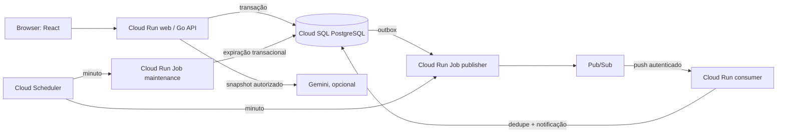

# Arquitetura

FlashCart é um monólito modular Go com React no mesmo domínio. Pedidos, estoque e idempotência são gravados numa transação PostgreSQL. Processos finitos cuidam de expirar reservas e publicar a outbox.



## Caminho de criação

```mermaid
sequenceDiagram
  participant UI as React
  participant API as Go API
  participant DB as PostgreSQL
  UI->>API: POST /session (cookie HttpOnly)
  UI->>API: POST /orders + Idempotency-Key
  API->>DB: BEGIN; lock session; verificar replay/limite
  API->>DB: decrementar estoque condicionalmente
  API->>DB: inserir pedido, chave e timeline
  API->>DB: COMMIT
  API-->>UI: pedido pendente + vencimento
```

## Limites e falhas

- Fonte de verdade é PostgreSQL; Cloud Pub/Sub entrega eventos pelo menos uma vez.
- Outbox torna pedido e evento duráveis na mesma transação. O consumer deduplica por `event_id` antes de confirmar a mensagem.
- O consumidor escreve notificação apenas no banco. Não há e-mail nem efeito financeiro.
- Cloud Run web e consumer usam o mesmo banco por ser uma demonstração de portfólio; não são microsserviços com bancos independentes.
- O teste de carga mede apenas o ambiente e os recursos reportados no respectivo relatório.

